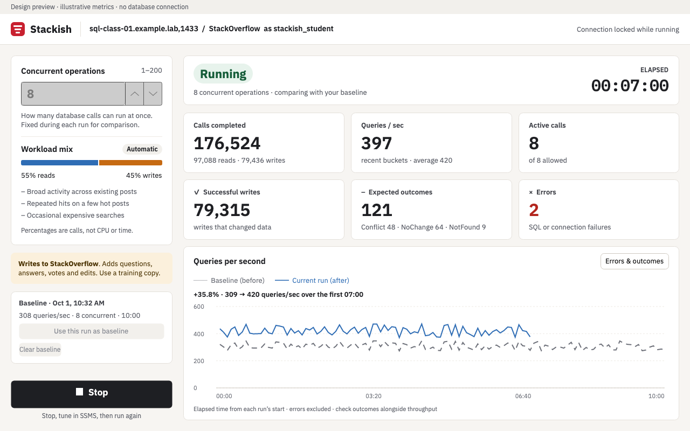
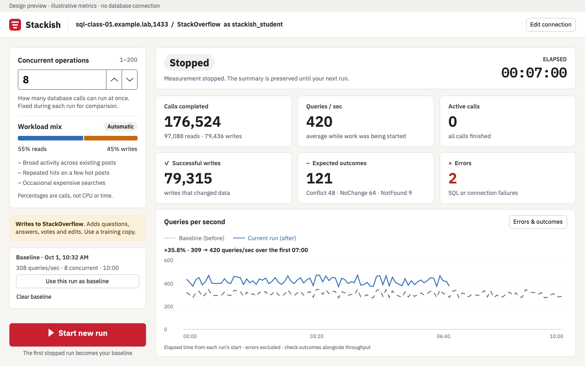

# Run the Stackish desktop workload

The first desktop version targets Windows and macOS. Use it to generate ongoing activity during migration rehearsals or compare before/after tuning runs. The app can install/update its procedures and function explicitly. It never changes indexes or restores data; the optional [index script](../../sql/indexes.sql) is separate. Linux packaging is deferred.

Mac downloads have been withdrawn after a bundle-signature defect was reproduced in the published ZIP. Build locally for now; the repaired packaging process verifies ZIP extraction but local ad-hoc signing does not establish Gatekeeper acceptance. The Windows preview remains available from [GitHub Releases](https://github.com/BrentOzarULTD/stackish/releases/tag/v0.1.0-preview.1). Extract the whole Windows archive and open `Stackish.exe` inside its folder. Keep the Windows companion files together. The packages include .NET; an SDK is only needed to build from source.

**Version note:** the published Windows Preview 1 lacks Install / update Stackish; deploy modules with `sql/deploy.sql` before connecting. The installer UI below is available in the current source and awaits updated downloads.

## Run, tune, compare

1. Restore your training database. Enter its connection details in the app and click **Install / update Stackish** for a fresh restore. This replaces Stackish module definitions and clears the saved baseline. Optional indexes are a separate choice in the [installation guide](../installation.md).
2. Open the app, enter the server/database and SQL login, then **Test connection**. That check verifies the engine, compatibility, schema, lookups and installed inventory without changing them. Passwords stay in memory and are never saved.
3. Choose concurrent operations and **Start workload**. The app selects eligible targets and opens worker connections before starting the measured interval. No SQL or parameter mappings are needed.
4. Click **Stop**. New calls stop, active calls drain, and the first nonfailed run of at least five seconds with completed calls becomes the baseline. After 30 seconds the app requests cancellation of remaining calls, then waits for the database driver to finish. Cancellation is not proof that a write did not commit.
5. Tune the database in SSMS. Return to Stackish and click **Start new run**. The saved baseline appears as a dashed gray curve and the new run as a solid blue curve, both aligned to elapsed time from their own start.
6. Repeat as needed. The baseline stays fixed until you click **Use this run as baseline** or **Clear baseline**. It survives closing the app. Neither action changes database data.

Concurrency is fixed during a run. A different server/database, login, concurrency, workload version or operation seed disables the percentage comparison. This is a deliberate change from the supplied mockup's live concurrency control. The curves remain visible with an explanatory message.

## What the chart measures

**Queries/sec means fully consumed, completed Stackish operation calls per second**, not individual T-SQL statements. Each invocation can execute several statements and return multiple result sets. SQL errors and canceled calls are excluded. Conflict, NoChange and NotFound are completed operations and count toward throughput, but are also shown separately. Higher QPS accompanied by many more no-op outcomes may not represent useful improvement.

Five-second buckets include zero-throughput intervals, so expensive queries and stalls are visible. Both curves share one elapsed-time axis and one rate axis; they are never stacked. The percentage compares the same completed five-second intervals from the beginning of both runs, ending at the shorter run's duration. It does not compare a short current average with an entire long baseline, extrapolate the current curve, or divide by a zero baseline. The live rate tile covers recent buckets; the stopped tile shows the full measured average.

Measurement freezes when Stop is pressed. Calls that finish while draining can still change the database, but are excluded from measured totals and QPS because concurrency is falling. Errors and cancellations during drain remain visible. Setup/connection time and time spent tuning are excluded.

The app reuses baseline target tuples and a repeatable per-worker operation/variant sequence for compatible runs. This improves comparability without pretending to be a deterministic database benchmark. Concurrent scheduling, cache state, background activity, text GUIDs and state-dependent votes/moderation still differ. Run long enough to include completions from the expensive reads when using the graph to assess tuning; the five-second minimum is a display rule, not a useful benchmark duration. The workload commits changes; it does not undo the first run. Warm/cold cache and changing data must be considered when teaching from the comparison. Clear the baseline after restoring/replacing the database or deliberately changing the target sample. No automated restore, cache flush, or compensating writes are performed.

## Maintainer testing copy

On Brent’s Mac, the latest delivered Apple Silicon app always lives at `/Users/brentozar/Applications/Stackish.app`. Open that same app after each update. The matching archive is `Stackish-latest.zip` in the same folder, and `Stackish-build.txt` records the source commit and verification. App changes must refresh and launch-check this copy before being reported complete. This local copy is separate from public GitHub releases.

## Build and run

Requires the .NET 10 SDK for development. Packaged builds include the runtime.

```sh
dotnet restore desktop/Stackish.slnx --locked-mode
dotnet test desktop/Stackish.Tests
dotnet run --project desktop/Stackish.Desktop
```

Generate self-contained developer builds (Mac packaging must run on macOS):

```sh
python3 desktop/package.py --runtime osx-arm64
python3 desktop/package.py --runtime osx-x64
python3 desktop/package.py --runtime win-x64
```

macOS output: `desktop/artifacts/<runtime>/Stackish.app`. Windows output: `desktop/artifacts/win-x64/publish/Stackish.exe`; keep its accompanying files together. Each runtime directory also contains a ZIP for validation. The Mac ZIP preserves the app executable permissions. Mac bundles receive an ad-hoc integrity signature and Windows builds remain unsigned. These are development builds, not Developer ID-signed/notarized public Mac installers. Native Windows execution and Intel Mac execution must be validated on those platforms before claiming release readiness. The CI workflow builds and tests the Windows/Mac targets without a database or credentials; it never starts a live workload.

Nonsecret connection settings and one baseline (including sampled IDs, measurements, and error summaries) are stored under the current user's local application-data directory in `Stackish/state.json`. It contains no password. A failed save is reported in the app. Do not commit local state or real connection details.

## Keyboard shortcuts

Windows: F5 starts and Shift+F5 stops. macOS: Command+R starts and Command+period stops. Escape closes the errors/outcomes drawer. Closing during a run asks to stop and quit.

## Screenshots for review

These are offline renders of the implemented controls with clearly marked illustrative data, not measured server performance.





## Installer validation

The maintainer client can exercise the exact app installer twice and compare all base-table index definitions before and after. It checks readiness after each installation and does not start a workload. Set the connection environment variables documented in the installation guide, then run:

```sh
dotnet run --project desktop/Stackish.LiveChecks -c Release -- --deploy-only --allow-mutations
```

Use `--trust-certificate` only for a lab server whose certificate policy requires it. Installation replaces Stackish module definitions; this is not a read-only check.

## Bounded maintainer validation

The separate live-check client uses the actual desktop engine for two finite runs, persists/reloads the first baseline, reuses targets and prints calls, outcomes, durations, stop/drain results and the matched comparison. It is not needed to operate the GUI and is never run in CI. With the four connection environment variables from the installation guide set locally:

```sh
dotnet run --project desktop/Stackish.LiveChecks -c Release -- --allow-mutations --seconds 60 --workers 4
```

Use `--trust-certificate` only when that is the intended certificate policy for your training server. The test commits real mutations. It requests Stop after the measured duration, drains/cancels exactly like the app, and finishes before starting the second run. Ctrl+C requests Stop; wait for it to finish. Its temporary baseline file is removed after validation. Output can contain nonsecret server/database/login settings and database error messages; keep raw evidence outside the repository. There is no tuning between these two runs, so a difference is a repeat-run observation, not proof of a tuning improvement.

For a longer single continuous run, use the same evidence client with an explicit duration and run count:

```sh
dotnet run --project desktop/Stackish.LiveChecks -c Release -- --allow-mutations --seconds 1800 --runs 1 --workers 8
```

`--seconds` is the measured duration per run (10–86,400 seconds); `--runs` accepts one or two and defaults to two. Setup and stopping time are additional. The normal desktop app still runs until you press Stop. The continuous check commits writes and includes expensive searches; its duration is not a guarantee of uniform throughput or uninterrupted successful writes.

## Verify the package before distribution

Packaging verifies a fresh extraction of the final ZIP. Mac verification checks executable permissions, the architecture of every Mach-O file, and the entire bundle signature, including nested runtime files. The notarized check also requires bundle identifier `com.brentozar.stackish` and the publisher’s Developer ID team `XRDGTMX2X9`; forks using their own certificate must pass `--expected-team THEIR_TEAM_ID`. Mac ZIPs use `ditto` to retain the signature metadata needed by managed assemblies.

Integrity verification alone is not a downloaded-app launch test. Before a Mac build is described as ready for public use, it must be Developer ID-signed and notarized, and the final downloaded archive must pass:

```sh
python3 desktop/verify_package.py Stackish-osx-arm64.zip --runtime osx-arm64 --require-notarized
```

Use `osx-x64` for Intel Mac. This requires both a valid stapled notarization ticket and Gatekeeper acceptance. Then test opening the downloaded app through Finder with download quarantine intact, on each supported Mac architecture. Test the downloaded Windows archive on Windows too. A local launch, CI build, checksum, or headless render does not substitute for those checks. Do not remove quarantine or disable Gatekeeper to make a distribution test pass.


## Complete the Mac release

The maintainer owns building, testing and publishing. The Apple account owner must handle enrollment, agreements, payment, sign-in and two-factor authentication. These steps do not require a new App Store listing.

1. **Account owner:** sign into the [Apple Developer Program](https://developer.apple.com/programs/enroll/). Use an existing membership, or enroll ($99 USD per year, with local pricing where available). Choose the intended individual or organization: the certificate identifies the publisher. Apple controls enrollment processing time.
2. **Maintainer with account-owner assistance:** create a **Developer ID Application** certificate using Xcode's certificate management or Apple's certificate portal and a locally generated certificate request. Keep the private key in this Mac's Keychain. Verify that `security find-identity -v -p codesigning` lists the identity. A distribution certificate for the App Store is not interchangeable.
3. **Account owner:** authorize notarization locally. Create an app-specific password for the developer Apple Account, then use the secure prompt below. Do not put the password in the command, repository, chat or logs. The profile name is not a secret.

```sh
xcrun notarytool store-credentials Stackish-notary --apple-id YOUR_APPLE_ID --team-id YOUR_TEAM_ID
```

4. **Maintainer:** build each Mac architecture with the installed certificate's exact name. The packager signs nested files before the bundle, enables hardened runtime and secure timestamps, and gives the .NET launcher its required JIT entitlement. It does not add debugger or disabled-library-validation entitlements. Signing alone does not establish notarization or release readiness.

```sh
python3 desktop/package.py --runtime osx-arm64 --signing-identity 'Developer ID Application: YOUR_NAME (YOUR_TEAM_ID)'
xcrun notarytool submit desktop/artifacts/osx-arm64/Stackish-osx-arm64.zip --keychain-profile Stackish-notary --output-format json
```

5. Save the returned submission ID outside the repository. Check the same submission until Apple finishes; do not resubmit while it is processing. **Proceed only if the status is Accepted.** For Invalid or unexpected results, retrieve the log, fix the cause and submit a new build. No public upload is automatic.

```sh
xcrun notarytool info SUBMISSION_ID --keychain-profile Stackish-notary --output-format json
xcrun notarytool log SUBMISSION_ID --keychain-profile Stackish-notary /tmp/stackish-notary-log.json
```

6. After acceptance, staple the ticket to the exact submitted app, then recreate the ZIP so the download includes the ticket. Do not modify or rebuild the app between submission and stapling. Verify this final archive:

```sh
xcrun stapler staple desktop/artifacts/osx-arm64/Stackish.app
ditto -c -k --sequesterRsrc --keepParent desktop/artifacts/osx-arm64/Stackish.app desktop/artifacts/osx-arm64/Stackish-osx-arm64-notarized.zip
python3 desktop/verify_package.py desktop/artifacts/osx-arm64/Stackish-osx-arm64-notarized.zip --runtime osx-arm64 --require-notarized
```

Repeat steps 4–6 with `osx-x64` for Intel. Keep release candidates in a draft GitHub release until validation passes. Retain submission IDs, commit SHA and final ZIP hashes with the test evidence outside the repo. CI's default artifacts remain development builds; this workflow does not require uploading Apple credentials to GitHub.

### Release acceptance checklist (maintainer responsibility)

- Download the exact GitHub candidate through a browser, extract it normally, and open it with quarantine and security settings intact. Check ARM64 on Apple silicon and x64 on Intel; emulation must be identified separately. Validate the Windows candidate on Windows. Obtain a suitable test machine or VM if needed; do not ask users to test the release for us.
- In each downloaded app, test connection, run a baseline, Stop, run a comparison, inspect errors/outcomes, then close and reopen to verify baseline persistence. Verify no workload connections remain after shutdown. Use the authorized disposable database and keep credentials outside test records.
- Run a 30-minute continuous workload from the downloaded app, record errors, operation outcomes, durations and successful reads/writes, and verify Stop/drain completes. Keep platform-specific results explicit; engine-only or screenshot tests do not count as GUI validation.
- Recheck hashes against tested candidates before publishing. Publish only the platforms that pass. If Apple rejects a build or a platform cannot be tested, leave that platform unavailable and report the exact remaining step. Do not remove quarantine, disable Gatekeeper or describe an untested app as ready.

Validation on October 2, 2026: both Mac architectures built from `ff8c649` were Developer ID-signed, accepted by Apple, stapled, and verified after ZIP extraction. Both pass Gatekeeper as Notarized Developer ID. The actual ARM64 candidate downloaded from the draft GitHub release has the same SHA-256 hash as the uploaded ZIP and opens successfully with quarantine explicitly added after the CLI download; this is not a browser-download test. Its readiness check correctly rejected the test database because all 43 Stackish objects were absent. Those older candidate ZIPs predate the in-app installer. The current installer backend subsequently passed two installations against the newly restored testbed with inventory checks and unchanged index definitions; a local ARM64 app also completed installation through its button and reached Ready. No workload ran during these installer checks. Updated signed downloads and downloaded-app workload validation remain pending. Native Windows and Intel Mac GUI validation remain outstanding; public Mac downloads remain withheld pending the release acceptance checks.
